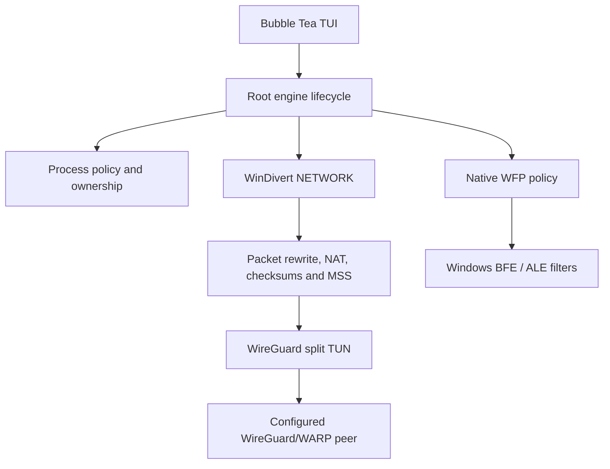

# AionWG

Selective WireGuard routing for Windows 11 x64, with a keyboard-first Bubble Tea TUI.

AionWG keeps the packet data path explicit: WinDivert captures and reinjects packets, the existing classifier applies process and route policy, and vendored WireGuard-go provides the encrypted tunnel. Native WFP user mode manages policy filters through `fwpuclnt.dll`; it is not a kernel packet callout.

## Current status

| Area | Status |
|---|---|
| Windows x64 executable | Supported |
| WireGuard profiles and split tunnel | Operational |
| WinDivert NETWORK capture/reinjection | Operational packet backend |
| WinDivert SOCKET process observation | Operational with system-table fallback |
| Native WFP User Mode Policy Engine | Implemented for App ID `BLOCK` filters; elevated Windows runtime validation required |
| WFP kernel callout driver | Not implemented |
| WARP-compatible profiles and opt-in multipath | Supported as AionWG behavior; no Cloudflare relay-topology guarantee |
| DPS mirror and Wintun meter path | Available |
| Linux runtime | Compatibility build/test environment only; packet engine is Windows-specific |

This repository is an incremental modernization, not a rewrite. The root Go `main` package remains while package extraction is prepared and documented in [`docs/architecture/overview.md`](docs/architecture/overview.md).

## Features

- Selective `TUNNEL`, `BYPASS`, `BLOCK` and `DEFAULT` process policies.
- WireGuard profile import, validation, endpoint selection and official-client export.
- Full-tunnel mode without changing Windows global routes.
- Conservative endpoint monitoring and route switching.
- Optional WARP multipath (`[h]`, disabled by default).
- UDP duplication, ratio control, force mode and newest-packet scheduling.
- DPS mirror through loopback and the `AionWG-Meter` Wintun adapter.
- Native WFP user-mode provider/sublayer and ALE App ID block filters.
- Runtime status, health counters, self-test and diagnostics.
- Embedded standalone runtime build with verified WinDivert, Wintun and Shugo assets.

Experimental UDP and multipath features can increase overhead, reorder traffic or expose different public exits. Enable them only when their counters and the real game session justify it.

## Architecture



Native WFP and WinDivert have different responsibilities:

- **Native WFP User Mode Policy:** creates AionWG-owned BFE objects and blocks selected executable App IDs.
- **WinDivert SOCKET:** observes process/socket ownership and discovers flows.
- **WinDivert NETWORK:** captures, rewrites, injects and reinjects packets.
- **WireGuard-go/Wintun:** WireGuard-go carries the tunnel; Wintun is used for the optional DPS meter mirror.
- **Kernel WFP:** absent. There is no `AionWFP.sys`, WDK project, INF, CAT, signing or IOCTL backend.

See the [documentation index](docs/INDEX.md) for packet flow, lifecycle, policies, security and the migration map.

## Requirements

- Windows 11 x64 for the application.
- Administrator elevation for WinDivert capture and embedded runtime extraction.
- A valid WireGuard profile and reachable peer.
- WinDivert/Wintun assets matching the build, unless using the standalone embedded build.
- Npcap only when using the DPS meter workflow.

The application requests elevation through UAC. Do not run an unknown binary as Administrator.

## Quick start

1. Build or download a Windows x64 package.
2. Import a `.conf` with `[i]`.
3. Select the profile and press `Enter`.
4. Select processes with `[p]`, or enable WFP mode with `[w]` and choose apps with `[l]`.
5. Connect before starting the game.
6. Use `[x]` and `[g]` when diagnosing a connection.
7. Press `q` to disconnect and exit.

Profiles and settings are stored under `%APPDATA%\AionWG`. Private keys are never included in release packages or normal diagnostics.

## TUI controls

| Key | Action |
|---|---|
| `Enter` / `c` | Connect or disconnect the selected profile |
| `↑` / `↓`, `k` / `j` | Navigate |
| `i` | Import a profile |
| `p` | Process rules |
| `w` / `l` | WFP mode and WFP applications |
| `s` / `n` | Full tunnel and tunnel DNS |
| `b` / `v` / `t` | Best route, endpoint and ping target |
| `m` | DPS mirror |
| `u` / `r` / `f` | UDP duplication, ratio and force |
| `o` / `a` | Newest outbound/inbound scheduling |
| `x` / `g` | Self-test and diagnostics |
| `e` | Export profiles for official WireGuard |
| `d` | Remove a profile |
| `h` | Opt-in WARP multipath |
| `F1`–`F10` | Dashboard and operational modules |
| `Ctrl+K`, `/`, `?`, `Esc`, `Tab` | Palette, search, help, back and focus navigation |
| `q` / `Ctrl+C` | Exit |

## Build from source

Pure-Go checks:

```bash
go test ./...
go test -race ./...
go vet ./...
go build ./...
```

Windows x64 cross-build, verified for `cmd/aionwg`:

```bash
GOOS=windows GOARCH=amd64 CGO_ENABLED=0 \
  go build -trimpath -ldflags='-s -w' \
  -o dist/AionWG.exe ./cmd/aionwg
```

Packaged build:

```bash
./build-aionwg-linux.sh --source "$PWD" --assets-dir "$PWD"
```

Native Windows:

```powershell
pwsh.exe -NoProfile -ExecutionPolicy Bypass `
  -File .\build-aionwg-windows.ps1 `
  -SourceDir "$PWD" -AssetsDir "$PWD"
```

Standalone embedded build:

```bash
./build-embedded.sh
```

`cmd/aionwg` is the canonical executable entrypoint. The root `main.go` remains as a compatibility wrapper for existing build commands.

## Security and privacy

- Imported `.conf` files contain private keys; keep them outside Git and support bundles.
- Logs may contain process names, remote IPs and ports; redact before sharing.
- Embedded runtime assets are content-addressed and verified before loading.
- The application does not install its self-signed build certificate into Windows Root or TrustedPublisher stores.
- Authenticode signing an EXE does not sign a kernel driver.
- The project license is MIT; third-party files keep their own notices and terms. See [`LICENSE`](LICENSE) and [`docs/security/licensing.md`](docs/security/licensing.md) before redistribution.

## Contributing

Read [`CONTRIBUTING.md`](CONTRIBUTING.md), run the supported checks, and keep Windows/network changes separate from mechanical moves. Do not include private profiles, keys, PFX files or generated binaries in pull requests.

Security reports should follow [`SECURITY.md`](SECURITY.md). Do not post private keys or sensitive VPN diagnostics in public issues.

## Third-party notices

- WinDivert: [`WinDivert-LICENSE.txt`](WinDivert-LICENSE.txt)
- WireGuard-go: [`third_party/wireguard-go/LICENSE`](third_party/wireguard-go/LICENSE)
- Vendored revision and local changes: [`third_party/wireguard-go/VENDORED.txt`](third_party/wireguard-go/VENDORED.txt)
- Wintun and native Shugo compatibility: review the release package and [`docs/security/licensing.md`](docs/security/licensing.md)
