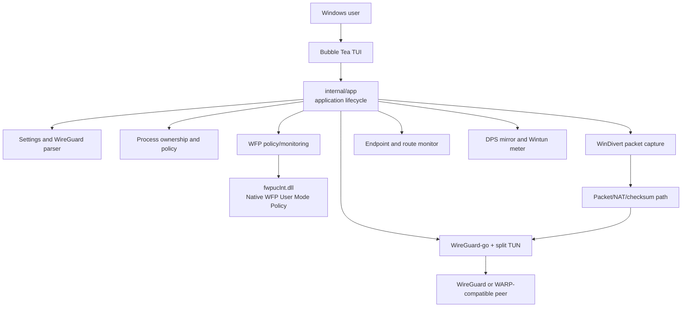
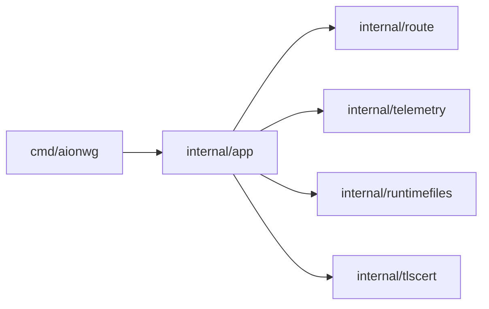

# Architecture overview

## Current system

The executable entrypoint is now `cmd/aionwg`, which calls `internal/app.Run`. The root `main.go` remains a compatibility launcher for existing `go build .` workflows. The Windows packet path stays in `internal/app` for now because it shares concrete hot-path types; `internal/route`, `internal/runtimefiles` and `internal/tlscert` are isolated packages.

## Proposed dependency direction

The application lifecycle and all Windows build-tagged runtime code now live in `internal/app`. Further decomposition into packet, capture, policy and TUI packages remains a separate behavior-preserving step.

## Source-to-destination migration map

| Current path | Target | Status | Risk and reason |
|---|---|---|---|
| `main_windows.go`, `main_other.go` | `cmd/aionwg`, `internal/app/entry_*.go` | Complete | `cmd/aionwg` is the canonical executable; root `main.go` preserves the legacy build command. |
| Root Go runtime files | `internal/app` | Complete | Mechanical package move; tests, Windows build tags and embedded asset paths were preserved. |
| `tui_windows.go`, endpoint picker files | `internal/tui` | Deferred | They now live in `internal/app`; split only after command and engine contracts are extracted. |
| `store.go`, `config.go` | `internal/config` | Deferred | JSON compatibility and private-key handling still need a narrower package boundary. |
| `wfp.go`, `owner_windows.go` | `internal/process`, `internal/policy` | Deferred | Process ownership and packet classification still share concrete engine types. |
| `divert_windows.go` | `internal/capture/windivert` | Deferred | Capture handles and address ABI need a behavior-preserving extraction. |
| `packet.go`, `splittun.go`, UDP files | `internal/packet`, `internal/tunnel` | Deferred | Hot path and buffer ownership need package-level interfaces and benchmarks. |
| `native_wfp*.go` | `internal/wfp` | Deferred | User-mode policy remains coupled to `Engine` lifecycle. |
| `route_compare.go` | `internal/route` | Complete | Ranking primitives are isolated; the compatibility facade remains in `internal/app`. |
| `bestendpoint.go`, `routemon.go`, `paths*.go` | `internal/route`, `internal/warp` | Deferred | Endpoint persistence and WARP multipath remain coupled to the Windows engine lifecycle. |
| `mirror.go`, `meterdedup.go`, `wintun_windows.go` | `internal/meter` | Deferred | DPS mirror and Wintun meter have distinct ownership and Windows constraints. |
| `internal/runtimefiles` | `internal/runtimefiles` | Complete | Already isolated; preserve embedded asset validation. |
| `internal/tlscert` | `internal/tlscert` | Complete | Public certificate remains build metadata only; runtime no longer needs to trust it. |
| build and release scripts | `scripts/` plus root wrappers | Complete | Existing scripts now build `./cmd/aionwg` and find assets under `internal/app`. |

## Invariants during migration

- The packet data path remains WinDivert NETWORK until a validated kernel callout exists.
- Native WFP user mode manages policy filters; it does not capture or reinject packets.
- `TUNNEL`, `BYPASS`, `BLOCK`, and `DEFAULT` retain their current semantics.
- Existing `%APPDATA%\\AionWG` settings and `.conf` profiles remain compatible.
- Build tags, embedded assets, executable names and release archive names remain stable.
