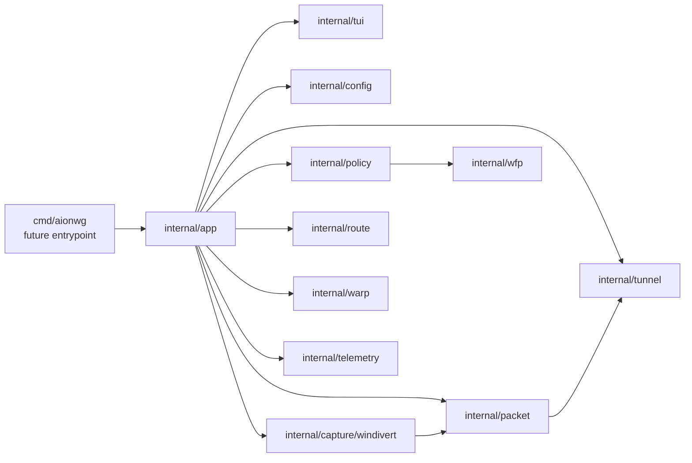

# Architecture overview

## Current system

The repository is currently one root `main` package. That is deliberate technical debt: Windows-specific files and the packet path share many concrete types, and moving them in one operation would make behavior changes difficult to review. The existing `internal/runtimefiles` and `internal/tlscert` packages already isolate runtime extraction and the public signing certificate.

## Proposed dependency direction

This graph is a migration target, not a claim that all packages already exist.

## Source-to-destination migration map

| Current path | Target | Status | Risk and reason |
|---|---|---|---|
| `main_windows.go`, `main_other.go` | `cmd/aionwg` | Deferred | Moving `package main` requires an application composition boundary. Preserve entrypoint until dependencies are extracted. |
| `tui_windows.go`, endpoint picker files | `internal/tui` | Deferred | TUI currently calls concrete engine/settings functions. Extract commands and state before moving views. |
| `store.go`, `config.go` | `internal/config` | Deferred | JSON compatibility and private-key handling need contract tests before package move. |
| `wfp.go`, `owner_windows.go` | `internal/process`, `internal/policy` | Deferred | Process ownership and packet classification currently share types and Windows fallbacks. |
| `divert_windows.go` | `internal/capture/windivert` | Deferred | Capture handles and address ABI must move without changing filters or reinjection. |
| `packet.go`, `splittun.go`, UDP files | `internal/packet`, `internal/tunnel` | Deferred | Hot path and buffer ownership need benchmarks and package-level interfaces first. |
| `native_wfp*.go` | `internal/wfp` | Deferred | Current user-mode policy engine is functional but coupled to `Engine` lifecycle. |
| `bestendpoint.go`, `route*.go`, `paths*.go` | `internal/route`, `internal/warp` | Deferred | Route persistence and WARP multipath must remain behaviorally identical. |
| `mirror.go`, `meterdedup.go`, `wintun_windows.go` | `internal/meter` | Deferred | DPS mirror and Wintun meter have distinct ownership and Windows constraints. |
| `internal/runtimefiles` | `internal/runtimefiles` | Complete | Already isolated; preserve embedded asset validation. |
| `internal/tlscert` | `internal/tlscert` | Complete | Public certificate remains build metadata only; runtime no longer needs to trust it. |
| build and release scripts | `scripts/` plus root wrappers | In progress | Consolidate commands without breaking existing user entrypoints. |

## Invariants during migration

- The packet data path remains WinDivert NETWORK until a validated kernel callout exists.
- Native WFP user mode manages policy filters; it does not capture or reinject packets.
- `TUNNEL`, `BYPASS`, `BLOCK`, and `DEFAULT` retain their current semantics.
- Existing `%APPDATA%\\AionWG` settings and `.conf` profiles remain compatible.
- Build tags, embedded assets, executable names and release archive names remain stable.
