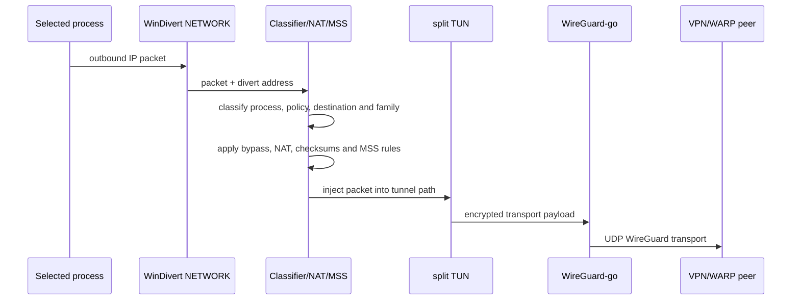
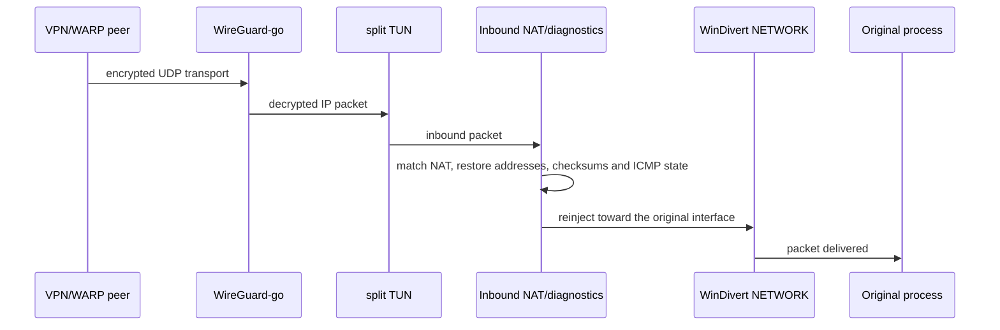

# Packet flow

## Outbound

`BYPASS` returns traffic to the normal Windows path. `BLOCK` is enforced by Native WFP ALE filters when a full executable identity can be resolved. WFP `PERMIT` is not used as a fake route redirect.

## Inbound

The Wintun adapter used by the DPS meter is a diagnostic mirror. It is not the primary tunnel interface.

## Buffer and shutdown rules

- Packet buffers are owned by the capture or tunnel queue until injection completes.
- Bounded queues may drop work and expose counters instead of blocking the packet path.
- Shutdown closes capture, tunnel and monitor handles, signals queues, waits for goroutines, then removes policy objects.
- Existing flows may keep their authorization after an ALE decision; changing a rule does not retroactively terminate every flow.
