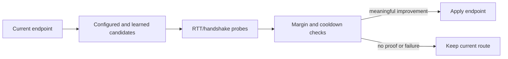

# Routing and WARP

Route selection measures the destination through the available path rather than assuming that an endpoint ping is equivalent to game latency. The current implementation maintains endpoint candidates, direct/tunnel ping state, learned endpoints and a conservative route switch policy.

The `[b]` route option is conservative: a marginal result should not interrupt an existing connection. The `[v]` endpoint action changes the active endpoint without rewriting the profile.

WARP multipath is an AionWG feature layered on independent WireGuard UDP paths. It is opt-in (`[h]`) and can produce different public exits or no improvement. AionWG does not control undisclosed internal Cloudflare relay topology.
