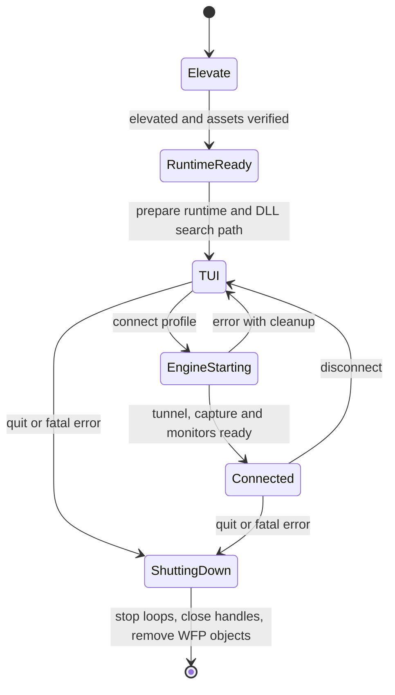

# Runtime lifecycle

Embedded builds verify and extract native files into a content-addressed directory under `Program Files\\AionWG-Runtime`. DLL loading is restricted to the verified runtime directory and Windows system directories. External builds use files beside the executable and are less self-contained.

The current entrypoint still lives in the root `main` package. The package migration is tracked in ADR 0001 and must preserve this lifecycle order.
