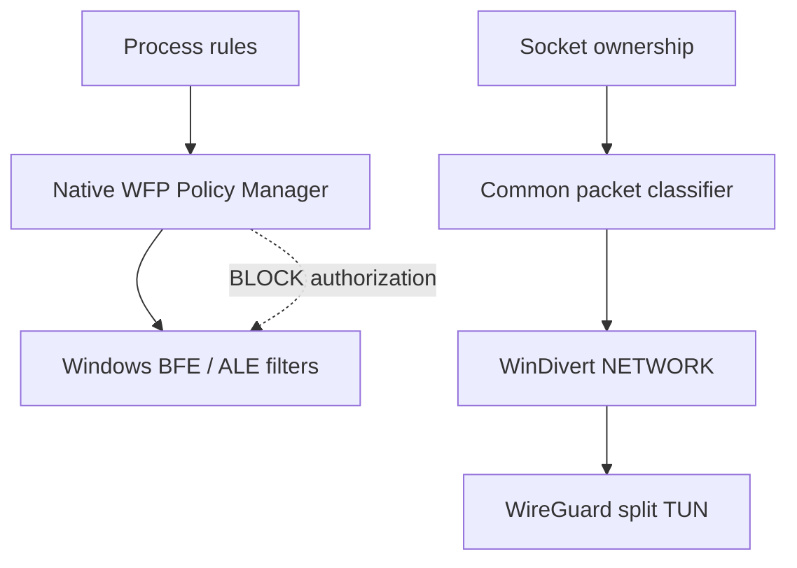

# WFP and WinDivert

AionWG has two different Windows networking roles:

| Component | Current responsibility | Status |
|---|---|---|
| Native WFP User Mode Policy Engine | BFE session, provider, sublayer and ALE `BLOCK` filters through `fwpuclnt.dll` | Implemented; runtime BFE validation still requires elevated Windows 11 |
| WinDivert SOCKET observation | Process/socket ownership and flow discovery | Implemented |
| WinDivert NETWORK backend | Packet capture, rewrite, tunnel injection and reinjection | Primary operational packet backend |
| Native WFP kernel packet engine | Callout capture/reinjection | Not implemented; no WDK driver, INF, CAT or signing |

The policy engine owns only AionWG provider objects and uses a dynamic session. It does not modify Windows Firewall or third-party filters. Filters are removed explicitly during normal shutdown and automatically with the dynamic session after a crash.

Do not label the current packet backend as `Native WFP Packet Engine`. That name is reserved for a future validated callout driver.
